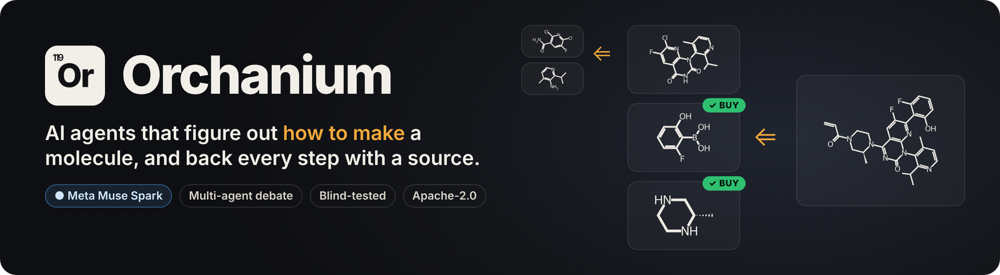
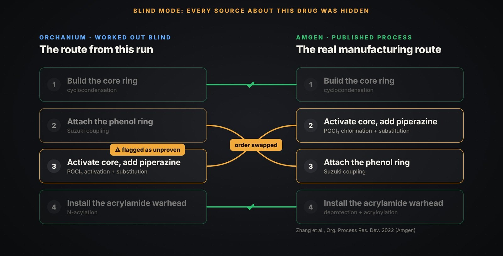
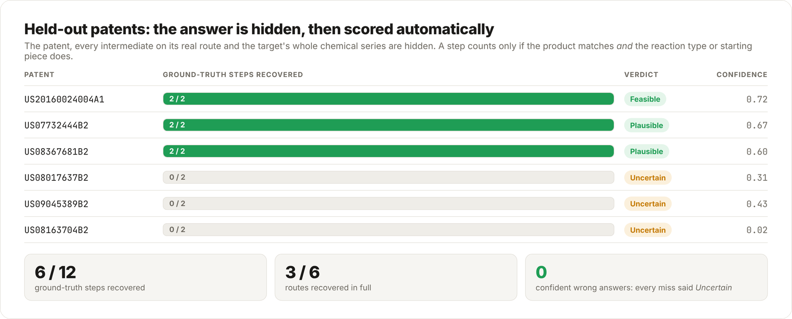
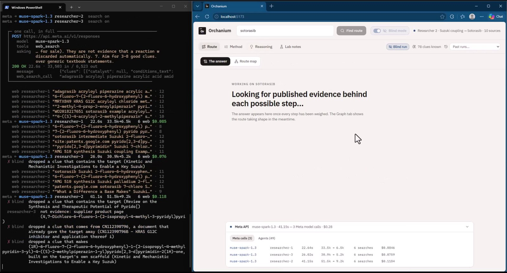
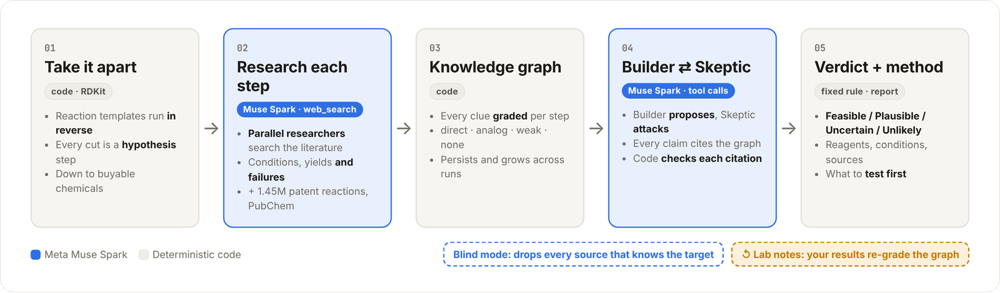
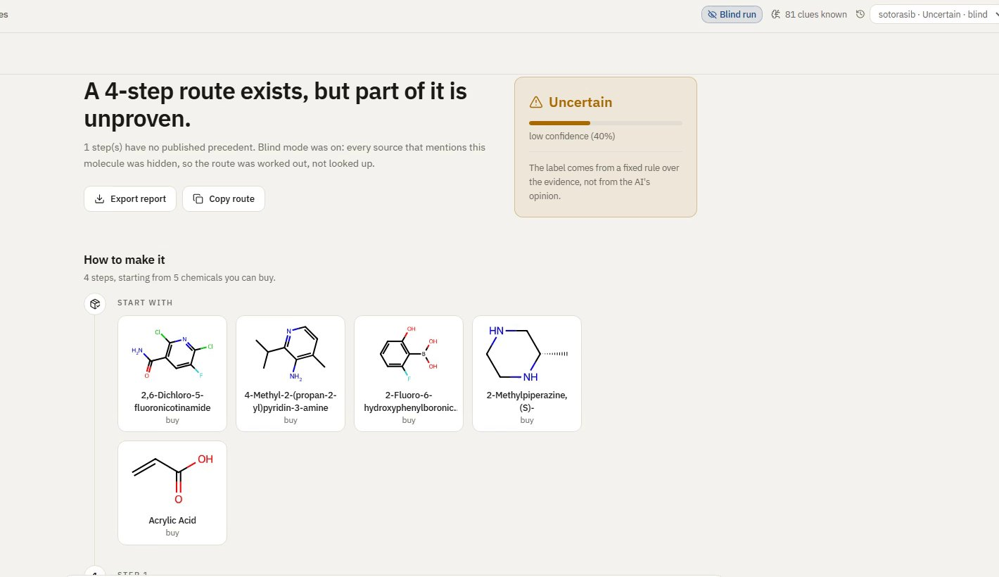
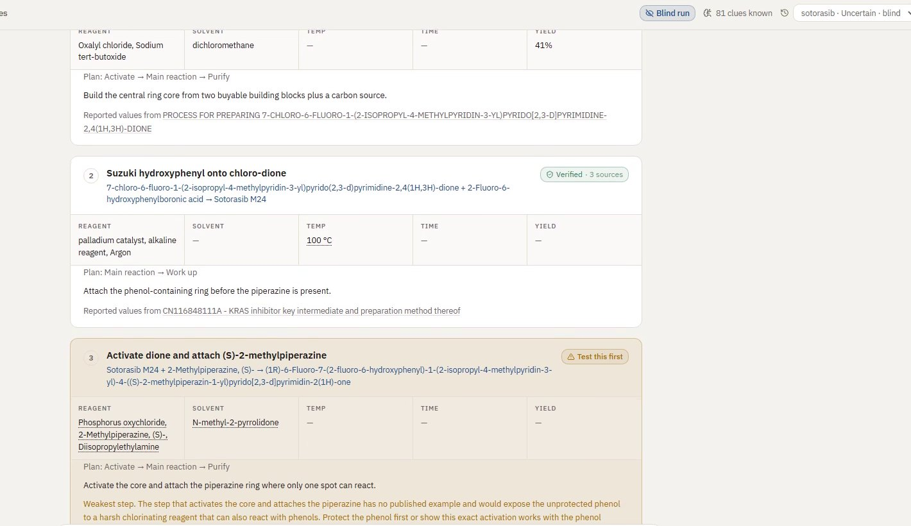
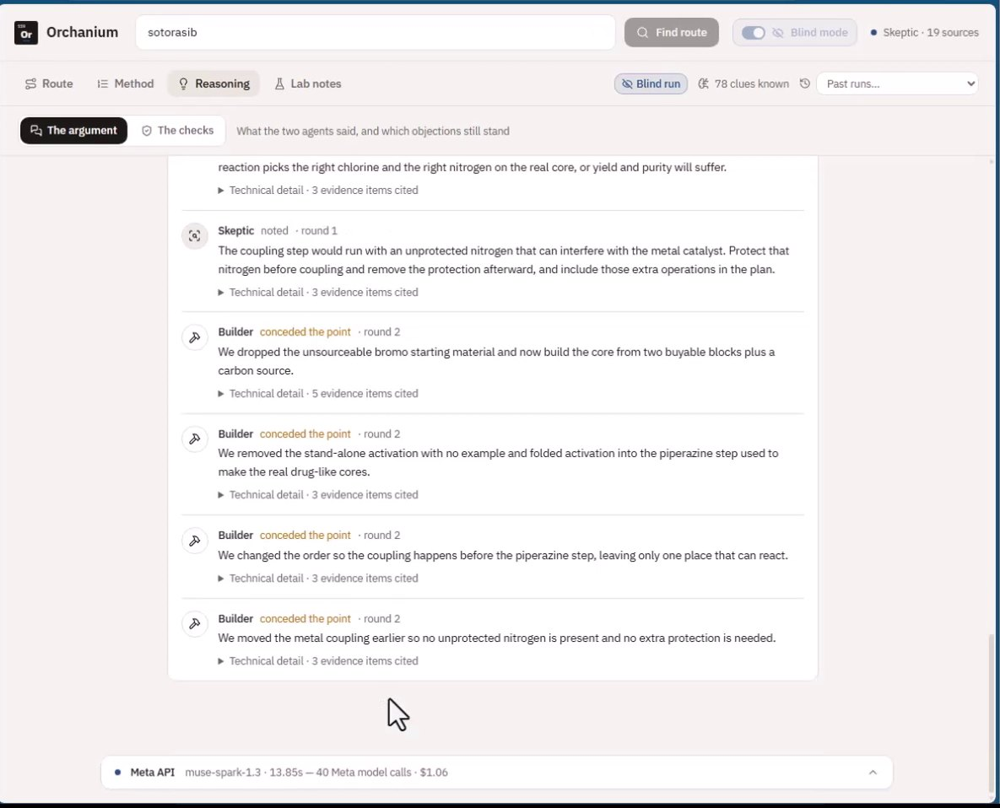
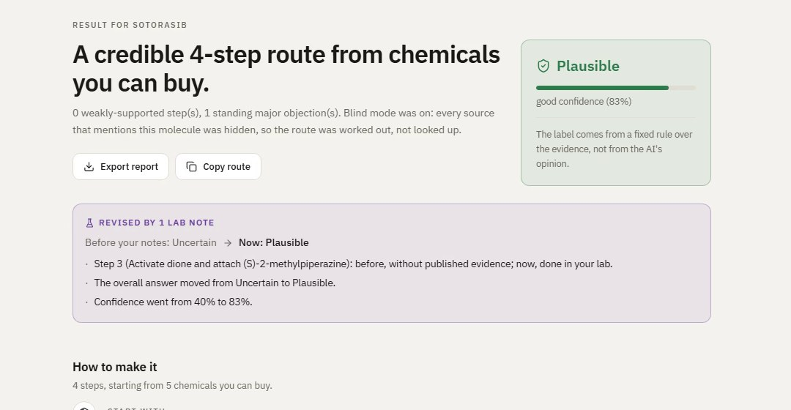

# Orchanium



[](https://www.youtube.com/watch?v=VFYUAe-Ta9s)
[](https://github.com/moayadMoatamed/Orchanium/actions/workflows/ci.yml)
[](#which-meta-models-do-what)
[](#quick-start)
[](LICENSE)

- **The problem.** Scientists can design a molecule that should treat a disease, a drug that
  shuts down a cancer protein, say. They know its final shape, not how to build it: which buyable
  chemicals to start from, which reactions in which order, and under what conditions. Working that
  out backwards (*retrosynthesis*) takes weeks of reading patents and papers, plus costly failed
  attempts in the lab.
- **What Orchanium does.** Type a molecule. Agents on **Meta Muse Spark** take it apart with real
  chemistry rules, research every step in the literature with live web search, argue the route out
  as a *Builder* and a *Skeptic*, and return a step-by-step method: starting materials, reagents,
  solvent, temperature, yield, the source of each, and what to test first.
- **How well.** In **blind mode**, with all 41 documents about the cancer drug sotorasib hidden,
  it reached the **same five building blocks and the same four reactions as the drug's published
  manufacturing route**, and flagged as unproven the one step where its order differs. On six
  held-out patents it recovered 6 of 12 steps, and **every miss came back *Uncertain*, never a
  confident wrong answer.**
- **How fast, how much.** One molecule in about 5–10 minutes and $0.30–$1.10 of API calls, with
  a hard $2.50 cap per run.
- **Who decides.** The model proposes and argues; the literature supplies the evidence;
  **deterministic code** draws structures, checks every citation and computes the verdict.



<p align="center"><sub>Sotorasib, blind: Orchanium's route vs Amgen's commercial process (<a href="https://doi.org/10.1021/acs.oprd.2c00249">Org. Process Res. Dev. 2022</a>). Full write-up, including what this does <i>not</i> prove: <a href="docs/blind-test-evidence.md">blind-test evidence</a>.</sub></p>

<p align="center"><sub>Built for the Meta Global AI Developer Hackathon (Oct 26 – Nov 4, 2026) · <a href="https://www.youtube.com/watch?v=VFYUAe-Ta9s">3-minute video</a> · evolved from <a href="https://github.com/moayadMoatamed/Orchanium-POC">Orchanium-POC</a>, rebuilt from scratch (<a href="#built-during-the-hackathon">what is new</a>) · <a href="#limitations">known gaps</a></sub></p>

## Quick start

**Watch first:** [3-minute demo video](https://www.youtube.com/watch?v=VFYUAe-Ta9s).

You need **Docker** and a **Meta Model API key**.

```bash
git clone https://github.com/moayadMoatamed/Orchanium.git
cd Orchanium
cp .env.example .env          # then open .env and set META_API_KEY=...
docker compose up --build     # or: make up
```

Open **http://localhost:5173**, type `ibuprofen` (or any molecule name or SMILES), and press
**Find route**. Turn on **Blind mode** to see it work without being able to look the answer up.

> The key is read from `.env` at runtime and never committed or baked into an image.
> If it is missing, the app says so as soon as you start a run. `http://localhost:8000/api/health`
> reports whether the key and the optional patent index are present.

### Without Docker

```bash
python -m venv .venv && . .venv/bin/activate      # Python 3.12
pip install -r backend/requirements.txt
cd backend && uvicorn orchanium.api:app --port 8000
```

```bash
cd frontend && npm install && npm run dev          # Node 20, opens on :5173
```

Or straight from the command line, no UI:

```bash
cd backend && python -m orchanium.cli run "ibuprofen" --blind
```

### Optional: the patent reaction index

Orchanium runs without it (web research and PubChem). With it, every step is also checked against
1.45M real patent reactions:

```bash
python scripts/download_uspto.py && python scripts/build_uspto_index.py   # ~2.4 GB download, ~20 min
python scripts/build_class_priors.py                                      # reaction-class base rates
```

Both land in `data/`, which Docker Compose mounts automatically.

### Configuration (`.env`)

| Variable | Meaning |
|---|---|
| `META_API_KEY` | Meta Model API key. **Required.** (`MODEL_API_KEY` also works) |
| `META_MODEL` | Model for the agents, default `muse-spark-1.3` |
| `FETCH_CONTACT_URL` | A URL identifying you (e.g. this repo), sent when checking citations; some sites refuse anonymous bots |
| `ORCHANIUM_NO_CACHE` | `1` makes every model call live (no cached responses), for reproducing or recording a run |

Per-run budgets (spend cap $2.50, call and search limits) are in
[`backend/orchanium/config.py`](backend/orchanium/config.py).

### Tests

```bash
cd backend && python -m pytest        # 54 tests: critic, scoring, schemas, blinding, lab notes
cd frontend && npx tsc --noEmit
```

## Results

<picture>
  <source media="(prefers-color-scheme: dark)" srcset="docs/assets/held-out-dark.png">
  
</picture>

| Target | Mode | Outcome | Cost |
|---|---|---|---|
| **Sotorasib** (Lumakras, KRAS G12C) | blind, 41 documents refused | Same 5 building blocks and 4 reactions as Amgen's route; the swapped step flagged as unproven. Uncertain, 0.40 | $1.08 |
| **Nirmatrelvir** (Paxlovid) | blind, 45 clues refused | The right disconnections (two amide couplings); said plainly the final step had no precedent left. Uncertain, 0.30 | $0.57 |
| **Ibuprofen** | normal | The real 3-step BHC industrial route, with conditions from the patents. Feasible, 0.97 | $0.48 |

The misses matter as much as the hits: one held-out target had no matching template, so the run
returned **no route** at 0.02 instead of inventing one, and another proposed a sound route in the
opposite order, which the strict scorer counts as zero. Details in
[blind-test evidence](docs/blind-test-evidence.md).

## Which Meta models do what

Every agent runs on **Meta Muse Spark** (`muse-spark-1.3`) through the Meta Model API.

| Job | Muse Spark does | Why it matters |
|---|---|---|
| **Research** | Parallel researchers call the built-in `web_search` tool to find reactions like each step: conditions, yields and failed attempts | The evidence everything rests on. With the drug's sources hidden, it still found the chemistry needed to rebuild the route |
| **Debate** | Builder and Skeptic reason over the graph through tool calls (`find_clues`, `precedents`, `get_node`, `propose_step`) for several rounds | The plan changes under objection, as a team of chemists would argue it out. On sotorasib the Builder conceded four points and rewrote the route |
| **Structured output** | Every agent answers in a strict JSON schema | Code verifies each citation against the graph and strikes anything uncited or invented |
| **Report** | Writes the method from the evidence | Reported values stay plain, inferred ones are marked |

Every call is visible during a run: the **Meta calls** panel lists model, latency, tokens and cost,
and the server log prints one full request and response per run.



## Inside a run

<picture>
  <source media="(prefers-color-scheme: dark)" srcset="docs/assets/how-it-works-dark.png">
  
</picture>

The model never invents a structure (names resolve through PubChem, structures come from
databases and RDKit), never scores its own evidence, and never picks the final label: a fixed
rule over the graph does. Architecture in depth: [docs/ARCHITECTURE.md](docs/ARCHITECTURE.md).

<table>
  <tr>
    <td width="50%"><br><sub><b>Route</b>: the answer, the verdict, what to buy, every step.</sub></td>
    <td width="50%"><br><sub><b>Method</b>: reagents, solvent, temperature, yield and source per step; the weakest step flagged.</sub></td>
  </tr>
  <tr>
    <td width="50%"><br><sub><b>Reasoning</b>: the Builder concedes and rewrites the plan.</sub></td>
    <td width="50%"><br><sub><b>Lab notes</b>: your own result re-grades the step; the verdict is recomputed and every change shown (example note).</sub></td>
  </tr>
</table>

## Using the app

| Tab | What you see |
|---|---|
| **Route** | The answer in one sentence, the verdict and confidence, what to buy, every step, and what to test first. *Route map* shows the graph building live |
| **Method** | The lab procedure: reagents, solvent, temperature, time and yield per step, each with its source. Plain = reported, underlined = inferred |
| **Reasoning** | The Builder/Skeptic exchange and the checks run on every citation |
| **Lab notes** | Record what happened when you ran a step. Your result outranks published work; the verdict is recomputed and later runs remember it |

**Past runs** can be reopened or replayed from the dropdown.

## Built during the hackathon

Orchanium started months ago as a small proof of concept,
[Orchanium-POC](https://github.com/moayadMoatamed/Orchanium-POC): one LLM proposed steps from a
fixed, hand-loaded Neo4j database, and RDKit checked them. **Everything in this repository was
built from scratch during the Meta Global AI Developer Hackathon** (commit history starts
30 Oct 2026), with a new architecture:

| Orchanium-POC (before) | Orchanium (built this week) |
|---|---|
| One LLM proposing steps | A multi-agent system on Meta Muse Spark: researchers, Builder, Skeptic, reporter |
| Fixed, hand-curated database | Evidence gathered **live** from the literature with web search, plus a 1.45M-reaction patent index |
| Graph as a static store | Knowledge graph built per run from graded evidence, which persists and grows across runs |
| Template match = answer | Builder/Skeptic debate with verified citations |
| — | Verdict computed by a fixed rule; confidence from the evidence |
| — | Blind mode to prove routes are reasoned, not looked up |
| — | Lab notes that revise answers; method write-up with sources |

## Repository layout

```
backend/orchanium/
  orchestrator.py    a run: decompose → research → debate → verdict, streamed as events
  agents/            planner · decomposer · researchers · Builder/Skeptic debate · verdict · reporter
  meta/client.py     Meta Model API client: strict JSON schemas, tool loop, budgets, call log
  clues.py graph.py  the evidence pipeline and the knowledge graph (blind-mode filters live here)
  chem/              RDKit: reaction templates, similarity, chemistry critic, purchasability
  sources/           web research · USPTO index
  lab.py             lab notes: your results as evidence, with recomputed verdicts
  api.py             FastAPI + resumable server-sent events
backend/prompts/     every agent prompt, in Markdown
frontend/src/        React UI; the whole interface is a reduction over the event stream
scripts/             patent index build, held-out evaluation, smoke tests
docs/                architecture, blind-test evidence, the original build plan
```

## Limitations

- Reasoning is at the level of which bonds can be formed from what, not reaction mechanisms.
- Source quality is not yet weighted: a patent and a blog post count the same once extracted.
- Many publishers block automated fetches, so many web citations end up "unverifiable"; patents
  check cleanly.
- Automatic disconnection is limited to the reaction-template registry (the Builder can go beyond it).
- A client for Meta's SAM 3.1 (reading reaction schemes from figures) is included in
  `meta/sam.py` but is not yet wired into runs.
- Agents are not deterministic, so the same input can give a slightly different route; the
  verdict rule applied to it is deterministic.

## License

[Apache 2.0](LICENSE)
