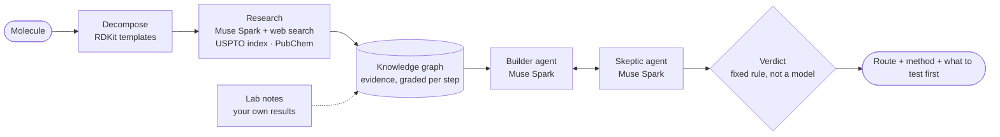
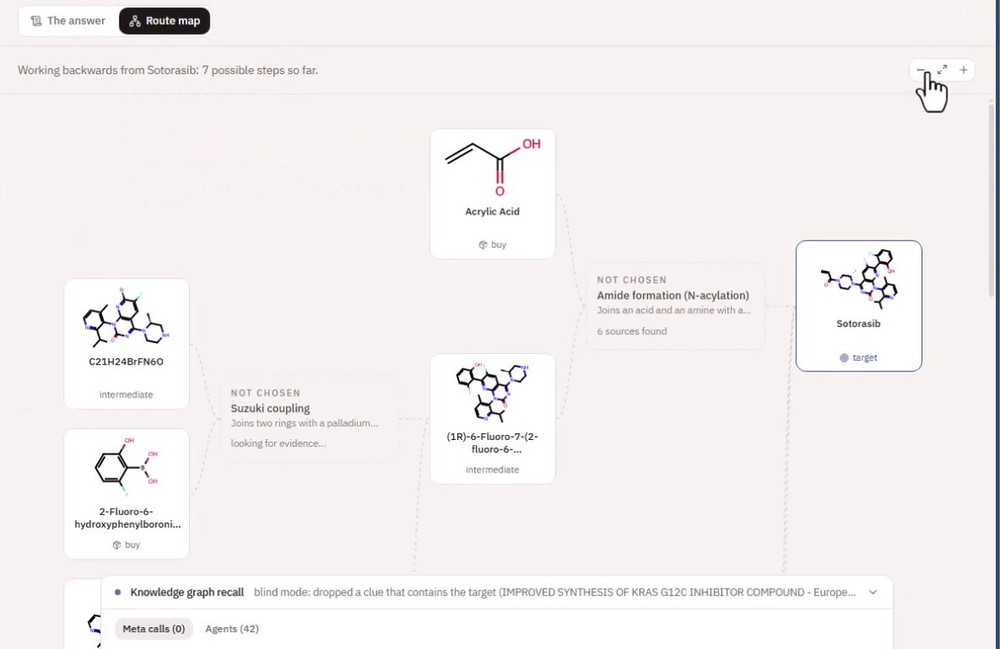

<p align="center">
  
</p>

<h1 align="center">Orchanium</h1>

<p align="center">
  <b>Can this molecule be made, and how?</b><br>
  AI agents on <b>Meta Muse Spark</b> research the chemistry literature, argue over the evidence,
  and return a step-by-step route to make a molecule, with every step backed by a source.
</p>

<p align="center">
  <a href="#quick-start">Quick start</a> ·
  <a href="#how-it-works">How it works</a> ·
  <a href="#where-metas-models-do-the-work">Meta models</a> ·
  <a href="#results">Results</a> ·
  <a href="docs/ARCHITECTURE.md">Architecture</a>
</p>

<p align="center"></p>

---

## The problem

Scientists can design a molecule that should treat a disease, say a drug that shuts down a cancer
protein. They know the **final shape**. What they don't know is **how to build it**: which
buyable chemicals to start from, which reactions to run in which order, and under what conditions
(temperature, solvent, catalyst) each step works.

Working that out backwards is called **retrosynthesis**. Today it means days to weeks of reading
patents and papers for every step, and failed, expensive attempts in the lab.

## What Orchanium does

You type a molecule (a name or a SMILES). Orchanium:

1. **Takes it apart** into possible steps using real chemistry rules (RDKit reaction templates).
2. **Researches every step.** Muse Spark agents search the web and published literature for
   reactions like it: conditions, yields, and failures too. A 1.45M-reaction patent index is
   searched as well.
3. **Builds a knowledge graph** of that evidence and grades each step against it.
4. **Debates the route.** A *Builder* agent proposes it, a *Skeptic* agent attacks every weak step,
   and the Builder revises. Every claim must cite evidence; code checks each citation.
5. **Computes a verdict** with a fixed rule over the evidence, not the model's opinion:
   *Feasible / Plausible / Uncertain / Unlikely*, with a confidence and the reason.
6. **Writes the guide:** buyable starting materials, each step's reagents, solvent, temperature,
   time and yield, the patent or paper it came from, and *what to test first*.

A run takes 5–10 minutes and costs about $0.30–$1.10 in API calls, with a hard cap per run.

## How it works



**The model proposes and argues. The literature provides the evidence. Deterministic code decides.**
The model never invents a structure (names resolve through PubChem, structures come from
databases and RDKit), never scores its own evidence, and never picks the final label.

## Where Meta's models do the work

Every agent runs on **Meta Muse Spark** (`muse-spark-1.3`) through the Meta Model API.

| Job | What Muse Spark does | Why it matters |
|---|---|---|
| **Research** | Parallel researcher agents use the built-in `web_search` tool to find published reactions like each step: conditions, yields, and failed attempts | This is the evidence everything else rests on. With every source that names the drug hidden, it still found the chemistry needed to rebuild the route |
| **Debate** | The Builder and the Skeptic reason over the graph with tool calls (`find_clues`, `precedents`, `get_node`, `propose_step`) over several rounds | The plan changes in response to objections, the way a team of chemists would argue it out |
| **Structured output** | Every agent answers in a strict JSON schema | Code verifies each citation against the graph and discards anything uncited or invented |
| **Report** | Writes the step-by-step method from the evidence | Reported values stay plain; inferred ones are marked |

Every call is visible while a run is live: the **Meta calls** panel in the UI lists model, latency,
tokens and cost, and the server log prints one full request and response per run.

<p align="center"></p>

## Results

**Blind mode** hides every source that names or describes the target, so the route has to be
reasoned out rather than looked up. It is how we test the system on drugs whose answers exist.

- **Sotorasib** (Lumakras, a KRAS G12C cancer drug). Blind, 41 documents refused, including the
  makers' own paper on the key coupling. Orchanium reached **the same five building blocks and
  the same four reactions as Amgen's published manufacturing route**
  ([Org. Process Res. Dev. 2022](https://doi.org/10.1021/acs.oprd.2c00249)). It ran two of the
  steps in the opposite order, and that is exactly the step it flagged as unproven. About
  8 minutes, 41 model calls, $1.08.
- **Nirmatrelvir** (Paxlovid). Blind: found the right disconnections, two amide couplings, and
  reported honestly that the final step had no published precedent left.
- **Ibuprofen** (not blind): recovered the real 3-step BHC industrial route with conditions from
  the patents. Feasible, 0.97.
- **Held-out patents:** 6 of 12 ground-truth steps recovered across 6 patents; **every miss came
  back Uncertain**, never a confident wrong answer.

Full write-up, including what these results do *not* prove:
[docs/blind-test-evidence.md](docs/blind-test-evidence.md).

<table>
  <tr>
    <td width="50%"><br><sub><b>Reasoning</b>: the Builder concedes four points and rewrites the plan.</sub></td>
    <td width="50%"><br><sub><b>Method</b>: reagents, solvent, temperature, yield and source for each step; the weakest step flagged.</sub></td>
  </tr>
  <tr>
    <td width="50%"><br><sub><b>Route map</b>: the molecule taken apart, live, down to buyable chemicals.</sub></td>
    <td width="50%"><br><sub><b>Lab notes</b>: log your own result on a step; the verdict is recomputed and every change is shown. (Example note.)</sub></td>
  </tr>
</table>

---

## Quick start

You need **Docker** and a **Meta Model API key**.

```bash
git clone https://github.com/moayadMoatamed/Orchanium.git
cd Orchanium
cp .env.example .env          # then open .env and set META_API_KEY=...
docker compose up --build
```

Open **http://localhost:5173**, type `ibuprofen` (or any molecule name or SMILES), and press
**Find route**. Turn on **Blind mode** to see it work without being able to look the answer up.

> The key is read from `.env` at runtime and never committed or baked into an image.
> If it is missing, the app says so as soon as you start a run. `http://localhost:8000/api/health`
> reports whether the key and the optional patent index are present.

### Without Docker

```bash
python -m venv .venv && . .venv/bin/activate      # Python 3.12
pip install -r backend/requirements.txt
cd backend && uvicorn orchanium.api:app --port 8000
```

```bash
cd frontend && npm install && npm run dev          # Node 20, opens on :5173
```

Or straight from the command line, no UI:

```bash
cd backend && python -m orchanium.cli run "ibuprofen" --blind
```

### Optional: the patent reaction index

Orchanium runs without it (web research and PubChem). With it, every step is also checked against
1.45M real patent reactions:

```bash
python scripts/download_uspto.py && python scripts/build_uspto_index.py   # ~2.4 GB download, ~20 min
python scripts/build_class_priors.py                                      # reaction-class base rates
```

Both land in `data/`, which Docker Compose mounts automatically.

### Configuration (`.env`)

| Variable | Meaning |
|---|---|
| `META_API_KEY` | Meta Model API key. **Required.** (`MODEL_API_KEY` also works) |
| `META_MODEL` | Model for the agents, default `muse-spark-1.3` |
| `FETCH_CONTACT_URL` | A URL identifying you (e.g. this repo), sent when checking citations; some sites refuse anonymous bots |
| `ORCHANIUM_NO_CACHE` | `1` makes every model call live (no cached responses), for reproducing or recording a run |

Per-run budgets (spend cap $2.50, call and search limits) are in
[`backend/orchanium/config.py`](backend/orchanium/config.py).

### Tests

```bash
cd backend && python -m pytest        # 54 tests: critic, scoring, schemas, blinding, lab notes
cd frontend && npx tsc --noEmit
```

## Using the app

| Tab | What you see |
|---|---|
| **Route** | The answer in one sentence, the verdict and confidence, what to buy, every step, and what to test first. *Route map* shows the graph building live |
| **Method** | The lab procedure: reagents, solvent, temperature, time and yield per step, each with its source. Plain = reported, underlined = inferred |
| **Reasoning** | The Builder/Skeptic exchange and the checks run on every citation |
| **Lab notes** | Record what happened when you ran a step. Your result outranks published work; the verdict is recomputed and later runs remember it |

**Past runs** can be reopened or replayed from the dropdown.

## Built during the hackathon

Orchanium started months ago as a small proof of concept,
[Orchanium-POC](https://github.com/moayadMoatamed/Orchanium-POC): one LLM proposed steps from a
fixed, hand-loaded Neo4j database, and RDKit checked them. **Everything in this repository was
built from scratch during the Meta Global AI Developer Hackathon** (commit history starts
30 Oct 2026), with a new architecture:

| Orchanium-POC (before) | Orchanium (built this week) |
|---|---|
| One LLM proposing steps | A multi-agent system on Meta Muse Spark: researchers, Builder, Skeptic, reporter |
| Fixed, hand-curated database | Evidence gathered **live** from the literature with web search, plus a 1.45M-reaction patent index |
| Graph as a static store | Knowledge graph built per run from graded evidence, which persists and grows across runs |
| Template match = answer | Builder/Skeptic debate with verified citations |
| — | Verdict computed by a fixed rule; confidence from the evidence |
| — | Blind mode to prove routes are reasoned, not looked up |
| — | Lab notes that revise answers; method write-up with sources |

## Repository layout

```
backend/orchanium/
  orchestrator.py    a run: decompose → research → debate → verdict, streamed as events
  agents/            planner · decomposer · researchers · Builder/Skeptic debate · verdict · reporter
  meta/client.py     Meta Model API client: strict JSON schemas, tool loop, budgets, call log
  clues.py graph.py  the evidence pipeline and the knowledge graph (blind-mode filters live here)
  chem/              RDKit: reaction templates, similarity, chemistry critic, purchasability
  sources/           web research · USPTO index
  lab.py             lab notes: your results as evidence, with recomputed verdicts
  api.py             FastAPI + resumable server-sent events
backend/prompts/     every agent prompt, in Markdown
frontend/src/        React UI; the whole interface is a reduction over the event stream
scripts/             patent index build, held-out evaluation, smoke tests
docs/                architecture, blind-test evidence, the original build plan
```

## Limitations

- Reasoning is at the level of which bonds can be formed from what, not reaction mechanisms.
- Source quality is not yet weighted: a patent and a blog post count the same once extracted.
- Many publishers block automated fetches, so many web citations end up "unverifiable"; patents
  check cleanly.
- Automatic disconnection is limited to the reaction-template registry (the Builder can go beyond it).
- A client for Meta's SAM 3.1 (reading reaction schemes from figures) is included in
  `meta/sam.py` but is not yet wired into runs.
- Agents are not deterministic, so the same input can give a slightly different route; the
  verdict rule applied to it is deterministic.

## License

[Apache 2.0](LICENSE)
